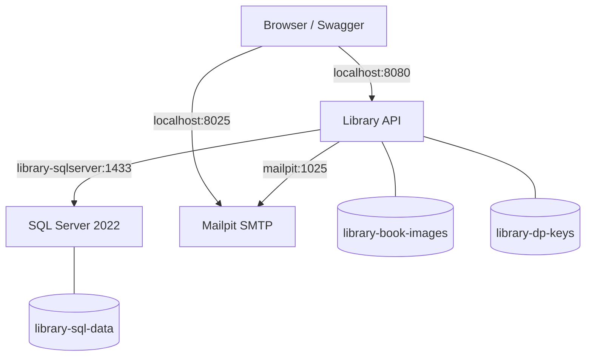

# Docker Setup Guide

This guide describes how to run the Library Management API in a containerized local development environment. It uses Docker Compose to run the ASP.NET Core API, SQL Server 2022, and Mailpit.

> This setup is intended for local development and testing, not production deployment.

## 1. Prerequisites

- Docker Desktop (or Docker Engine with the Docker Compose v2 plugin), running Linux containers.
- Git.
- .NET 10 SDK and the EF Core CLI (`dotnet-ef` 10.0.10, matching the project version used during setup) on the host for the database migration step.
- PowerShell. The commands in this guide use PowerShell syntax.
- Sufficient memory for SQL Server and the API. SQL Server's Linux container requires a supported x86-64 environment.

After cloning the repository, open a terminal in the repository root, where `LibraryManagement.slnx`, `Dockerfile`, and `compose.yaml` are located.

```powershell
docker --version
docker compose version
dotnet --version
dotnet ef --version
```

If the EF Core CLI is not installed:

```powershell
dotnet tool install --global dotnet-ef --version 10.0.10
```

If it is already installed, ensure its major version matches EF Core 10.

## 2. Docker Architecture

The Dockerfile uses a multi-stage build. The .NET SDK image restores dependencies and publishes the application in Release configuration. The ASP.NET Core runtime image runs the published application on port 8080.

The runtime container runs as the non-root application user `app` (UID and GID 1654 in the verified image). During the image build, writable directories are prepared for book covers, Data Protection keys, and development logs. Application binaries remain separate from these writable directories.

Serilog writes to the console in all environments and writes rolling log files under `/app/logs` only in Development. Production uses console logging.



All three services communicate over the `library-network` Docker network.

| Compose service | Container | Host address | Container port |
|---|---|---|---|
| `library-api` | `library-api-test` | `127.0.0.1:8080` | 8080 |
| `library-sqlserver` | `library-sqlserver` | `127.0.0.1:14333` | 1433 |
| `mailpit` | `library-mailpit` | `127.0.0.1:8025` | 8025 (UI), 1025 (SMTP) |

SQL Server's health check verifies that the database engine accepts connections before Compose starts the API. It does not apply application migrations or verify that the application database schema is ready.

## 3. Environment Configuration

The repository includes two configuration templates:

| Template | Local file | Purpose |
|---|---|---|
| `.env.example` | `.env` | API configuration, JWT settings, database connection and email settings |
| `.env.sqlserver.example` | `.env.sqlserver` | SQL Server configuration and SA password |

The actual environment files are ignored by Git and excluded from the Docker build context. Never commit generated secrets or reuse local development credentials in production.

### Generate local secrets (first-time setup only)

Run the following block from the repository root. It creates a random 64-byte Base64 JWT signing key and a random SQL Server password, then populates both environment files from the templates. It refuses to overwrite existing files.

```powershell
& {
    $ErrorActionPreference = 'Stop'
    if ((Test-Path .env) -or (Test-Path .env.sqlserver)) {
        throw 'Environment files already exist. Do not overwrite them.'
    }

    $apiTemplate = Get-Content .env.example -Raw
    $sqlTemplate = Get-Content .env.sqlserver.example -Raw

    if (-not $apiTemplate.Contains('REPLACE_WITH_GENERATED_SECRET_KEY') -or
        -not $apiTemplate.Contains('REPLACE_WITH_SQL_PASSWORD') -or
        -not $sqlTemplate.Contains('REPLACE_WITH_SQL_PASSWORD')) {
        throw 'Expected placeholders are missing from the templates.'
    }

    $rng = [System.Security.Cryptography.RandomNumberGenerator]::Create()
    try {
        $jwtBytes = New-Object byte[] 64
        $sqlBytes = New-Object byte[] 32
        $rng.GetBytes($jwtBytes)
        $rng.GetBytes($sqlBytes)
        $jwtKey = [Convert]::ToBase64String($jwtBytes)
        $sqlPassword = 'Sql!9a' + [Convert]::ToBase64String($sqlBytes)

        $apiTemplate.Replace('REPLACE_WITH_GENERATED_SECRET_KEY', $jwtKey).Replace('REPLACE_WITH_SQL_PASSWORD', $sqlPassword) |
            Set-Content .env -Encoding ASCII
        $sqlTemplate.Replace('REPLACE_WITH_SQL_PASSWORD', $sqlPassword) |
            Set-Content .env.sqlserver -Encoding ASCII
    }
    finally {
        $rng.Dispose()
    }
    Write-Host 'Local environment files created.'
}
```

If reusing an existing SQL Server volume, retain its matching password or rotate the existing SQL login explicitly. Changing `MSSQL_SA_PASSWORD` in an environment file alone does not reliably reset the password stored in an initialized SQL Server volume.

Verify that the real environment files are ignored and are not tracked:

```powershell
git check-ignore .env .env.sqlserver
git ls-files -- .env .env.sqlserver
```

The first command should list both files. The second should produce no output. Do not publish the contents of these files or the output of an unfiltered `docker compose config` command.

## 4. Initialize the Docker Network and Storage

The Compose file declares the network `library-network` and the SQL Server volume `library-sql-data` as external resources. They must exist before starting the services.

```powershell
if (-not (docker network ls --filter 'name=^library-network$' --format '{{.Name}}')) {
    docker network create library-network
}
if (-not (docker volume ls --filter 'name=^library-sql-data$' --format '{{.Name}}')) {
    docker volume create library-sql-data
}
```

Compose creates `library-book-images` and `library-dp-keys` automatically if they do not already exist.

For an existing installation that previously ran the API as root, follow the one-time volume ownership migration in section 7 before starting the API with the new non-root image. A fresh installation does not require this migration.

## 5. Start SQL Server and Apply Migrations

Validate the Compose configuration without displaying resolved secrets:

```powershell
docker compose config --quiet
```

### Start SQL Server

Start SQL Server first and wait until it is healthy:

```powershell
docker compose up -d library-sqlserver
docker compose ps
```

Ensure that the SQL Server container reports a `healthy` status before proceeding.

### Restore NuGet Packages

Before applying database migrations, restore the solution dependencies and verify that the solution builds successfully.

```powershell
dotnet restore LibraryManagement.slnx
dotnet build LibraryManagement.slnx --no-restore
```

This step is required for a fresh clone because generated build files, including `obj/project.assets.json`, are not tracked by Git.

Skipping the restore step may cause the `NETSDK1004` error when running EF Core migrations.

### Apply EF Core Migrations

Run the existing EF Core migrations from the host. The host connects through port 14333, whereas the API container connects through `library-sqlserver:1433`.

The following block reads the SQL password locally without printing it and uses the explicit host connection string for the migration. The project directory is named `Presistence` in the repository.

```powershell
& {
    $passwordLine = Get-Content .env.sqlserver |
        Where-Object { $_ -match '^MSSQL_SA_PASSWORD=' }

    if (@($passwordLine).Count -ne 1) {
        throw 'Expected exactly one MSSQL_SA_PASSWORD entry.'
    }

    $password = ($passwordLine -split '=', 2)[1]

    if ([string]::IsNullOrWhiteSpace($password)) {
        throw 'SQL Server password is empty.'
    }

    $connection = "Server=127.0.0.1,14333;Database=LibraryManagement;User Id=sa;Password=$password;Encrypt=True;TrustServerCertificate=True"

    dotnet ef database update `
        --project Infrastructure/Presistence/LibraryManagement.Persistence.csproj `
        --startup-project LibraryManagement.API/LibraryManagement.API.csproj `
        --context ApplicationDbContext `
        --connection $connection

    if ($LASTEXITCODE -ne 0) {
        throw 'EF Core migration failed.'
    }
}
```

This local-development command passes the connection string to a child process; use an appropriate secret-management and migration workflow in production.

Existing migrations create the application schema and seed the predefined roles. Do not generate a new migration simply to start an existing checkout.

The application now validates its database and JWT settings at startup. If EF Core tooling needs to construct the application host, provide the required local configuration to that process as well; Docker's `env_file` settings are not automatically loaded by host-side `dotnet ef` commands. The migration workflow above has not yet been re-verified from a fresh clone after the new startup validation was introduced.

See [SETUP.md](SETUP.md) for the non-Docker development workflow.

## 6. Build and Start the Application

For existing installations with root-owned application volumes, complete the ownership migration in section 7 first.

```powershell
docker compose up -d --build
docker compose ps
```

Expected state:

- `library-api-test`: running.
- `library-sqlserver`: running and healthy.
- `library-mailpit`: running (allow its health check to complete).

Open the following local addresses:

- Swagger UI: http://localhost:8080/swagger/index.html
- Mailpit inbox: http://localhost:8025
- Liveness check: http://localhost:8080/health
- Readiness check: http://localhost:8080/health/ready

Both health endpoints should return HTTP 200 with `Healthy` when the application is running and the database is reachable. `/health` checks application responsiveness without querying the database. `/health/ready` checks database connectivity through EF Core; it does not validate the complete database schema or all dependencies. An unhealthy database readiness check returns HTTP 503.

Verify database connectivity by executing `GET /api/v1/books` in Swagger. A successful response is expected to return HTTP 200; a fresh database can return an empty collection.

## 7. Persistent Storage

| Volume | Container mount path | Purpose |
|---|---|---|
| `library-sql-data` | `/var/opt/mssql` | Database files and SQL Server state |
| `library-book-images` | `/app/wwwroot/uploads/books` | Uploaded book covers |
| `library-dp-keys` | `/home/app/.aspnet/DataProtection-Keys` | ASP.NET Core Data Protection keys |

These volumes preserve data across container recreation. Data Protection keys are persisted for token-related functionality that depends on ASP.NET Core Data Protection; the JWT signing key is configured separately.

Inspect the uploaded book covers:

```powershell
docker compose exec library-api ls -lh /app/wwwroot/uploads/books
```

Recreate only the API container and inspect the files again:

```powershell
docker compose up -d --force-recreate --no-deps library-api
docker compose exec library-api ls -lh /app/wwwroot/uploads/books
```

After uploading a cover via Swagger, its returned relative URL can be opened using `http://localhost:8080` as the base URL. Verify that the same image is still available after recreating the API container.

Named volumes are not backups. Mailpit messages are not configured with a dedicated persistent volume in this Compose setup.

### Migrating Existing Volume Permissions

This one-time migration is for existing installations that previously ran the API as root. Updating the Dockerfile does not change the ownership of files already stored in named volumes.

Stop the API and build the updated image:

```powershell
docker compose stop library-api
docker compose build library-api
```

Verify that both application volumes exist before proceeding:

```powershell
docker volume inspect library-book-images library-dp-keys --format '{{.Name}}'
```

Both volume names must be listed. If either volume is missing or the command fails, stop and investigate before proceeding.

Update the volume ownership using a temporary root container. This command assumes the volumes use the names declared in `compose.yaml` and the updated application image uses UID and GID 1654:

```powershell
docker run --rm --user 0:0 `
    --mount type=volume,source=library-book-images,target=/mnt/books `
    --mount type=volume,source=library-dp-keys,target=/mnt/keys `
    --entrypoint /bin/sh `
    librarymanagement-api:dev `
    -c "chown -R 1654:1654 /mnt/books /mnt/keys && chmod 700 /mnt/keys && ls -ld /mnt/books /mnt/keys"
```

Confirm that both directories are owned by `app:app` and that the key directory has permissions `700`. If the command fails, resolve the error before starting the API.

Restart the application:

```powershell
docker compose up -d
```

Verify the runtime user and writable directories:

```powershell
docker compose exec library-api id
docker compose exec library-api sh -c "test -w /app/wwwroot/uploads/books && test -w /home/app/.aspnet/DataProtection-Keys && test -w /app/logs && echo 'All directories are writable'"
```

Expected output:

```text
uid=1654(app) gid=1654(app) groups=1654(app)
All directories are writable
```

This migration changes ownership and permissions without deleting the existing book covers or Data Protection keys. It does not modify the SQL Server volume. Do not use `docker compose down -v` to resolve a permissions issue.

## 8. Local Email Testing with Mailpit

Mailpit captures SMTP messages locally without delivering them to real recipients. The API uses the following development settings from the environment template:

| Setting | Value |
|---|---|
| `EmailOptions__SmtpServer` | `mailpit` |
| `EmailOptions__Port` | `1025` |
| `EmailOptions__SenderName` | `Library Management` |
| `EmailOptions__SenderEmail` | `noreply@library.example.com` |
| `EmailOptions__Username` / `EmailOptions__Password` | Empty |
| `EmailOptions__UseLocalSmtp` | `true` |
| `EmailOptions__FrontendBaseUrl` | `http://localhost:4200` |

The local SMTP option disables TLS and SMTP authentication only when explicitly enabled in the Development environment. Startup configuration validation rejects local SMTP outside Development. Keep it disabled for real SMTP providers.

### Email confirmation

1. Register a test account using `POST /api/v1/auth/register` with a fictional email address, such as `docker-email@example.com`.
2. Call `POST /api/v1/auth/send-email-confirmation` with that email. Registration does not automatically send the confirmation message in the tested workflow.
3. Open Mailpit and locate the confirmation message.
4. Copy the confirmation link and extract the decoded `token` query parameter.
5. Submit the email and token to `POST /api/v1/auth/confirm-email` in Swagger.
6. Verify that the endpoint succeeds and that `EmailConfirmed` is set to `1` in the database.

The link targets the frontend on port 4200. If no frontend is running, opening it in a browser will fail; the token can still be submitted directly through Swagger.

To extract the token in Windows PowerShell without printing its value, run the following block, then copy the link from Mailpit when prompted:

```powershell
Add-Type -AssemblyName System.Web
$link = Read-Host 'Paste the email link'
$url = [Uri]$link
$token = [System.Web.HttpUtility]::ParseQueryString($url.Query)['token']
if ([string]::IsNullOrWhiteSpace($token)) { throw 'No token found.' }
Set-Clipboard -Value $token
```

Paste the token into the relevant Swagger request body. Do not share email tokens, reset links, or authorization headers. Clear the clipboard when finished.

### Password reset

1. Call `POST /api/v1/auth/forgot-password` with the test email.
2. Locate the password reset message in Mailpit.
3. Extract its token using the same procedure.
4. Submit the email, reset token and new password to `POST /api/v1/auth/reset-password`, following the Swagger request schema.
5. Verify that login works with the new password. Also test that the old password is rejected.

## 9. Useful Docker Commands

| Command | Purpose |
|---|---|
| `docker compose ps` | Check service status |
| `docker compose logs --tail=100 library-api` | Inspect recent API logs |
| `docker compose logs --tail=100 library-sqlserver` | Inspect database logs |
| `docker compose logs --tail=100 mailpit` | Inspect Mailpit logs |
| `docker compose up -d --build` | Rebuild and start the application |
| `docker compose stop` | Stop services without removing containers |
| `docker compose up -d` | Start or resume services |
| `docker compose down` | Remove Compose containers while retaining named volumes by default |

Avoid `docker compose down -v` unless you intentionally want to delete Compose-managed named volumes, including uploaded images and Data Protection keys. The externally managed network and SQL volume are not removed by that command. Explicit removal of the SQL volume destroys its stored database data.

## 10. Troubleshooting

| Symptom | What to check |
|---|---|
| External network or volume not found | Initialize the external resources in section 4. |
| SQL Server is unhealthy | Check SQL logs, available resources, and whether the password matches the existing database volume. |
| Database login fails | Ensure the SQL password matches in both environment files and in the SQL Server login. |
| Application database or tables missing | Apply the existing EF Core migrations using section 5. |
| API is unreachable | Check `docker compose ps`, API logs and the host port binding. |
| JWT configuration or expiration error | Verify that the JWT signing key is at least 32 UTF-8 bytes long, that issuer and audience are configured, and that both token lifetimes are positive. |
| Database connection string is missing | Configure `ConnectionStrings__DefaultConnection` for the environment in which the API starts. |
| Application volume permission denied | For existing root-owned volumes, follow the one-time ownership migration in section 7. Do not delete the volumes or run the application as root. |
| Liveness is healthy but readiness is unhealthy | Check the application database connection string, credentials, and SQL Server availability. |
| Local SMTP validation fails outside Development | Set `EmailOptions__UseLocalSmtp=false` and configure an appropriate SMTP provider if email delivery is required. |
| Book cover upload returns HTTP 400 | Select an actual file in Swagger; do not send an empty multipart file field. |
| SMTP email does not appear | Call the correct email endpoint, verify Mailpit is running and check the API logs for SMTP errors. |
| Confirmation link fails to open | The frontend may not be running on port 4200. Use Swagger as described in section 8. |
| HTTPS redirection warning in local logs | The Compose API endpoint uses HTTP on port 8080; configure HTTPS separately for production. |
| Port already in use | Stop the conflicting service or change the host mapping and update dependent host-side commands. |

## 11. Verification and Production Considerations

The containerized development setup has been manually exercised for database migrations, registration and login, Member/Librarian authorization, category/author/book creation, book cover upload and persistence, Data Protection key persistence, Mailpit delivery, email confirmation and password reset followed by successful login with the new password.

The updated non-root setup has also been checked for volume ownership migration, runtime UID and GID, writable application directories, successful startup, and both application health endpoints.

These checks are not a complete regression suite. For additional API scenarios, see [TESTING.md](TESTING.md).

### Local Production Smoke Test

The default Compose configuration remains intended for Development. To check Production startup locally, build the updated API image and ensure SQL Server is running and healthy:

```powershell
docker compose build library-api
docker compose up -d library-sqlserver
docker compose ps
```

Run a temporary Production container on a separate loopback port:

```powershell
docker compose run -d --rm --no-deps `
    --name library-api-production-test `
    -p 127.0.0.1:8081:8080 `
    -e ASPNETCORE_ENVIRONMENT=Production `
    -e Swagger__Enabled=true `
    -e EmailOptions__UseLocalSmtp=false `
    library-api
```

This test reuses the local development database, environment file, and application volumes. It is not an isolated production deployment. Use it only for startup and read-only connectivity checks; do not send emails or modify stored data. Do not expose this container publicly or reuse the local credentials in a public deployment.

Review startup logs:

```powershell
docker logs --tail=20 library-api-production-test
```

Check the following addresses:

- Swagger UI: http://localhost:8081/swagger/index.html
- Liveness check: http://localhost:8081/health
- Readiness check: http://localhost:8081/health/ready

The expected result is successful startup in the Production environment, an accessible Swagger UI, and two healthy health checks. Swagger is disabled in Production by default and is explicitly enabled for this test only. Local SMTP is disabled, and Serilog uses console logging instead of file logging.

Stop the temporary container after testing:

```powershell
docker stop library-api-production-test
```

The `--rm` option removes the temporary container on exit; it does not delete the named volumes.

A local Production smoke test has been completed. Public hosting and deployment verification are pending.

### Public Deployment Considerations

Before a public deployment, use a separate production configuration with HTTPS, securely managed secrets, a least-privilege database account, protected Data Protection keys, backups, appropriate health monitoring and a deliberate migration strategy. If email functionality is offered, configure real SMTP with TLS and authentication; otherwise document that email delivery is unavailable in the demo. Do not expose the development Mailpit service or reuse the test accounts. Review and pin container image versions for reproducible releases.

See [SECURITY.md](SECURITY.md) and [DEPLOYMENT.md](DEPLOYMENT.md) for the project's security and release guidance.
